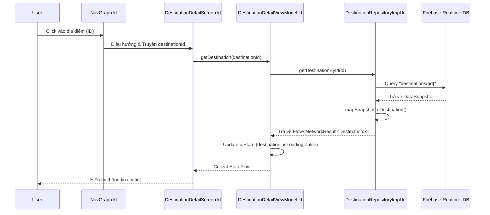

# Phân tích Luồng Hoạt động: Tính năng Địa điểm (Place/Destination)

Tài liệu này giải thích chi tiết cách ứng dụng TravelMate xử lý dữ liệu cho tính năng xem chi tiết địa điểm, đi từ giao diện người dùng đến tầng dữ liệu Firebase.

---

## 1. Sơ đồ Hoạt động (Activity Flow Diagram)



---

## 2. Giải thích Chi tiết qua từng Tệp tin

### Bước 1: Điều hướng (Navigation)
**Tệp:** `ui/navigation/NavGraph.kt`
Khi người dùng nhấn vào một thẻ địa điểm ở màn hình Explore hoặc Home, ứng dụng sử dụng `navController` để chuyển hướng.
```kotlin
composable(
    route = Screen.DestinationDetail.route,
    arguments = listOf(navArgument("destinationId") { type = NavType.StringType })
) { backStackEntry ->
    val destinationId = backStackEntry.arguments?.getString("destinationId") ?: ""
    DestinationDetailScreen(
        destinationId = destinationId,
        onBackClick = { navController.popBackStack() },
        onPlanTripClick = { 
            navController.navigate(Screen.PlanTrip.route + "?destinationId=$destinationId")
        },
        onWriteReviewClick = { id ->
            navController.navigate(Screen.WriteReview.createRoute(id))
        }
    )
}
```

### Bước 2: Giao diện (UI Layer)
**Tệp:** `ui/screen/DestinationDetailScreen.kt`
Màn hình này sử dụng `LaunchedEffect` để yêu cầu dữ liệu ngay khi vừa được khởi tạo.
- **Code quan trọng:**
  ```kotlin
  LaunchedEffect(destinationId) {
      viewModel.getDestination(destinationId)
  }
  ```
- Nó quan sát `uiState` từ ViewModel để quyết định hiển thị Loading (xoay tròn), Lỗi, hoặc thông tin Địa điểm.

### Bước 3: Xử lý Trạng thái (ViewModel Layer)
**Tệp:** `ui/viewmodel/DestinationDetailViewModel.kt`
ViewModel đóng vai trò trung gian, quản lý trạng thái của màn hình (`DestinationDetailUiState`).
- **Hàm xử lý chính:**
  ```kotlin
  fun getDestination(id: String) {
      destinationJob?.cancel() // Hủy bỏ yêu cầu cũ nếu có
      destinationJob = viewModelScope.launch {
          destinationRepository.getDestinationById(id).collect { result ->
              when (result) {
                  is NetworkResult.Loading -> _uiState.update { it.copy(isLoading = true) }
                  is NetworkResult.Success -> _uiState.update { 
                      it.copy(destination = result.data, isLoading = false) 
                  }
                  is NetworkResult.Error -> _uiState.update { 
                      it.copy(error = result.message, isLoading = false) 
                  }
              }
          }
      }
  }
  ```

### Bước 4: Hợp đồng Dữ liệu (Domain Layer)
**Tệp:** `domain/repository/DestinationRepository.kt` & `domain/model/Destination.kt`
- Tầng này định nghĩa **giao diện (Interface)** mà ViewModel gọi tới, giúp code dễ kiểm thử hơn.
- `Destination.kt` là một Data Class chứa các thuộc tính như `name`, `description`, `location`, `rating`, `images`...

### Bước 5: Thực thi và Truy vấn Dữ liệu (Data Layer)
**Tệp:** `data/repository/DestinationRepositoryImpl.kt`
Đây là nơi code thực tế tương tác với Firebase.
- **`getDestinationById(id)`**: Tạo một kết nối tới node `destinations/{id}` trên Firebase.
- **`mapSnapshotToDestination()`**: Một hàm cực kỳ quan trọng giúp chuyển đổi dữ liệu thô từ Firebase (`DataSnapshot`) sang đối tượng Kotlin `Destination`. Nó xử lý các trường hợp dữ liệu bị thiếu hoặc sai kiểu để ứng dụng không bị crash.
  ```kotlin
  private fun mapSnapshotToDestination(snapshot: DataSnapshot): Destination {
      return Destination(
          id = snapshot.key ?: "",
          name = snapshot.child("name").value.toString(),
          description = snapshot.child("description").value.toString(),
          location = snapshot.child("location").value.toString(),
          rating = safeDouble(snapshot.child("rating")), // Hàm tiện ích xử lý số thực
          // ... mapping các trường khác
      )
  }
  ```

---

## 3. Tại sao cấu trúc như vậy?
1.  **Tách biệt trách nhiệm (Separation of Concerns):** UI chỉ lo hiển thị, ViewModel lo trạng thái, Repository lo dữ liệu.
2.  **Dễ bảo trì:** Nếu sau này bạn muốn đổi từ Firebase sang một Database khác, bạn chỉ cần sửa code trong `DestinationRepositoryImpl.kt`, các file giao diện và ViewModel hoàn toàn không bị ảnh hưởng.
3.  **Real-time:** Nhờ sử dụng `Flow` kết hợp với `ValueEventListener` của Firebase, ứng dụng có thể cập nhật thông tin địa điểm ngay lập tức nếu dữ liệu trên server thay đổi.
